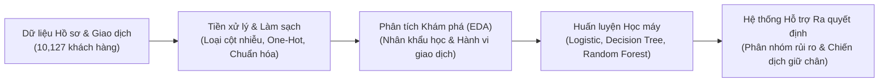

# BÁO CÁO DỰ ÁN KHOA HỌC DỮ LIỆU

> [!IMPORTANT]
> **Tên đề tài đăng ký**: Dự đoán nguy cơ khách hàng ngừng sử dụng dịch vụ thẻ tín dụng nhằm hỗ trợ ra quyết định giữ chân khách hàng tại ngân hàng  
> **Nguồn dữ liệu**: [Credit Card Customers - Kaggle (`sakshigoyal7/credit-card-customers`)](https://www.kaggle.com/datasets/sakshigoyal7/credit-card-customers)  
> **Thuật toán phân tích**: `Logistic Regression`, `Decision Tree`, `Random Forest`  
> **Thư mục dự án trên máy**: `/Users/phamquang/.gemini/antigravity/scratch/credit-card-churn-project`

---

## 1. Đặt vấn đề & Quy trình Hỗ trợ Ra quyết định

Trong hoạt động ngân hàng bán lẻ, chi phí thu hút một khách hàng mở thẻ tín dụng mới cao gấp **5 – 7 lần** so với chi phí giữ chân khách hàng hiện hữu. Tuy nhiên, phần lớn ngân hàng chỉ ghi nhận sự rời bỏ (*Customer Churn*) khi khách hàng đã chủ động yêu cầu khóa thẻ, làm thất thoát nguồn thu từ phí thường niên, phí chiết khấu giao dịch và lãi suất dư nợ tín dụng quay vòng.

Dự án này xây dựng quy trình Khoa học Dữ liệu khép kín nhằm dự báo sớm nguy cơ rời bỏ thẻ tín dụng và cung cấp các ngưỡng hành động cụ thể cho bộ phận Chăm sóc Khách hàng (Retention Team):



---

## 2. Mô tả Tập dữ liệu & Tiền xử lý (Data Preprocessing)

Tập dữ liệu [BankChurners.csv](file:///Users/phamquang/.gemini/antigravity/scratch/credit-card-churn-project/BankChurners.csv) bao gồm **10,127 bản ghi khách hàng** với **23 cột ban đầu**.
- **Làm sạch cột dư thừa**: Loại bỏ cột mã định danh `CLIENTNUM` và 2 cột xác suất tạo sẵn `Naive_Bayes_Classifier_...` ở cuối bảng theo khuyến nghị của tác giả bộ dữ liệu, giữ lại **20 thuộc tính chuẩn** (19 biến đầu vào và 1 biến mục tiêu `Attrition_Flag`).
- **Kiểm tra dữ liệu khuyết thiếu**: **0 giá trị bị khuyết (Null/NaN)**.
- **Mã hóa biến mục tiêu (`Churn`)**:
  - `0` (`Existing Customer` – Khách hàng hiện hữu): **8,500 khách hàng (83.93%)**
  - `1` (`Attrited Customer` – Khách hàng rời bỏ): **1,627 khách hàng (16.07%)**

| Nhóm thuộc tính | Tên biến trong tập dữ liệu | Ý nghĩa nghiệp vụ |
| :--- | :--- | :--- |
| **Nhân khẩu học** | `Customer_Age`, `Gender`, `Dependent_count`, `Education_Level`, `Marital_Status`, `Income_Category` | Độ tuổi, giới tính, số người phụ thuộc, trình độ học vấn, tình trạng hôn nhân, nhóm thu nhập năm |
| **Quan hệ ngân hàng** | `Card_Category`, `Months_on_book`, `Total_Relationship_Count`, `Months_Inactive_12_mon`, `Contacts_Count_12_mon` | Hạng thẻ (Blue/Silver/Gold/Platinum), thời gian gắn bó (tháng), tổng số sản phẩm sử dụng, số tháng không giao dịch và số lần liên hệ tổng đài trong 12 tháng |
| **Hạn mức & Dư nợ** | `Credit_Limit`, `Total_Revolving_Bal`, `Avg_Open_To_Buy`, `Avg_Utilization_Ratio` | Hạn mức tín dụng, dư nợ tín dụng quay vòng, hạn mức khả dụng trung bình, tỷ lệ sử dụng hạn mức |
| **Hành vi giao dịch** | `Total_Trans_Amt`, `Total_Trans_Ct`, `Total_Amt_Chng_Q4_Q1`, `Total_Ct_Chng_Q4_Q1` | Tổng giá trị & tổng số lần giao dịch trong 12 tháng; tỷ lệ thay đổi giá trị & số lần giao dịch Quý 4 so với Quý 1 |

---

## 3. Phân tích Khám phá Dữ liệu (EDA)

````carousel

<!-- slide -->

<!-- slide -->

<!-- slide -->

<!-- slide -->

````

### Các phát hiện quan trọng từ EDA:

| Chỉ số phân tích | Khách hàng Hiện hữu (`0`) | Khách hàng Rời bỏ (`1`) | Nhận xét & Ý nghĩa Quản trị |
| :--- | :---: | :---: | :--- |
| **Tổng số lần giao dịch (`Total_Trans_Ct`)** | **68.67 lần/năm** | **44.93 lần/năm** | Nhóm rời bỏ giao dịch ít hơn **34.6%**. Ngưỡng **< 55 giao dịch/năm** tập trung phần lớn khách hàng hủy thẻ. |
| **Tổng giá trị giao dịch (`Total_Trans_Amt`)** | **4,654.66 USD** | **3,095.03 USD** | Chi tiêu của nhóm rời bỏ thấp hơn trung bình **1,559 USD/năm**. |
| **Biến động tần suất Q4/Q1 (`Total_Ct_Chng_Q4_Q1`)** | **0.74** | **0.55** | Sự sụt giảm tần suất quẹt thẻ ở Quý 4 so với Quý 1 là tín hiệu cảnh báo sớm trước khi khách hàng đóng thẻ. |
| **Dư nợ quay vòng (`Total_Revolving_Bal`)** | **1,256.60 USD** | **672.82 USD** | Khách hàng tất toán hết dư nợ quay vòng có xu hướng dễ rời bỏ hơn khách hàng đang duy trì dư nợ trả góp/quay vòng. |
| **Số lần liên hệ tổng đài (`Contacts_Count_12_mon`)** | **2.36 lần** | **2.97 lần** | Khi khách hàng liên hệ ngân hàng từ **3 lần trở lên**, tỷ lệ hủy thẻ tăng mạnh; đặc biệt ở mức **6 lần liên hệ**, **100% khách hàng rời bỏ**. |

---

## 4. Kết quả Huấn luyện & Đánh giá Mô hình Học máy

Tập dữ liệu được chia theo tỷ lệ **80% Huấn luyện (8,101 mẫu)** và **20% Kiểm thử (2,026 mẫu)** có phân tầng (`stratify=y`). Ba thuật toán học máy được huấn luyện và kiểm định độc lập:

| Thuật toán | Accuracy (%) | Precision (%) | Recall (%) | F1-Score (%) | ROC-AUC (%) | Đánh giá ưu thế |
| :--- | :---: | :---: | :---: | :---: | :---: | :--- |
| **Logistic Regression** *(balanced)* | 85.49% | 53.09% | **81.85%** | 64.41% | 92.07% | **Recall cao nhất**, phát hiện được nhiều khách hàng có nguy cơ rời bỏ nhất (chỉ sót 59/325 trường hợp). |
| **Decision Tree** *(max_depth=6)* | 93.58% | 84.45% | 73.54% | 78.62% | 95.76% | Cân bằng tốt, cung cấp **cây quy tắc IF-THEN** minh bạch cho chuyên viên ngân hàng. |
| **Random Forest** *(200 cây)* | **95.06%** | **92.78%** | 75.08% | **82.99%** | **98.38%** | **Hiệu năng tổng thể vượt trội nhất** trên mọi thước đo tổng hợp (Accuracy, Precision, F1, ROC-AUC). |

````carousel

<!-- slide -->

<!-- slide -->

````

### Top 5 biến quan trọng nhất quyết định hành vi rời bỏ (Random Forest Feature Importance):
1. `Total_Trans_Ct` (**17.63%**): Tổng số lần giao dịch trong 12 tháng.
2. `Total_Trans_Amt` (**17.37%**): Tổng giá trị giao dịch trong 12 tháng.
3. `Total_Ct_Chng_Q4_Q1` (**11.08%**): Tỷ lệ thay đổi số lần giao dịch Quý 4 so với Quý 1.
4. `Total_Revolving_Bal` (**10.85%**): Tổng dư nợ tín dụng quay vòng.
5. `Avg_Utilization_Ratio` (**7.15%**): Tỷ lệ sử dụng hạn mức tín dụng trung bình.

---

## 5. Đề xuất Hệ thống Hỗ trợ Ra quyết định (Decision Support System)

Từ kết quả thực nghiệm, ngân hàng có thể tích hợp mô hình **Random Forest** (kết hợp ngưỡng xác suất từ **Logistic Regression**) vào hệ thống CRM để tự động phân luồng khách hàng theo **3 kịch bản ra quyết định**:

| Phân nhóm Rủi ro | Dấu hiệu nhận diện từ dữ liệu | Quyết định Can thiệp Đề xuất |
| :--- | :--- | :--- |
| **Nhóm 1: Suy giảm gắn kết chi tiêu** | `Total_Trans_Ct < 55` **và** `Total_Ct_Chng_Q4_Q1 < 0.65` | Gửi thông báo tự động qua App/SMS tặng **Cashback 5–10%** hoặc miễn phí thường niên nếu phát sinh tối thiểu 5 giao dịch trong 30 ngày kế tiếp. |
| **Nhóm 2: Bức xúc dịch vụ / Khiếu nại** | `Contacts_Count_12_mon >= 3` **hoặc** `Months_Inactive_12_mon >= 3` | Gắn cờ **Cảnh báo Đỏ** trên màn hình tổng đài viên; chuyển thẳng cuộc gọi cho **Đội Chăm sóc Ưu tiên (Retention Specialist)** để xử lý dứt điểm vướng mắc ngay lập tức. |
| **Nhóm 3: Ngủ đông hạn mức tín dụng** | `Total_Revolving_Bal == 0` **và** `Avg_Utilization_Ratio < 0.10` | Chào mời gói **Chuyển đổi trả góp 0% lãi suất** hoặc ưu đãi rút tiền mặt/chi tiêu linh hoạt nhằm khôi phục dư nợ quay vòng trên thẻ. |

---

## 6. Danh mục File Bàn giao (Đã tạo sẵn trên máy)

Toàn bộ mã nguồn, dữ liệu, biểu đồ và báo cáo đã được đóng gói tại thư mục `/Users/phamquang/.gemini/antigravity/scratch/credit-card-churn-project`:

- **Báo cáo Word hoàn chỉnh (`.docx`)**: [Bao_Cao_Du_An_Khoa_Hoc_Du_Lieu.docx](file:///Users/phamquang/.gemini/antigravity/scratch/credit-card-churn-project/Bao_Cao_Du_An_Khoa_Hoc_Du_Lieu.docx) *(Đã chèn sẵn đầy đủ bảng biểu và 8 hình ảnh biểu đồ chất lượng cao, có thể nộp ngay)*.
- **Jupyter Notebook (`.ipynb`)**: [Credit_Card_Churn_Analysis.ipynb](file:///Users/phamquang/.gemini/antigravity/scratch/credit-card-churn-project/Credit_Card_Churn_Analysis.ipynb) *(Đã chạy sẵn toàn bộ kết quả & biểu đồ hiển thị trực tiếp bên trong từng cell)*.
- **Tập dữ liệu gốc (`.csv`)**: [BankChurners.csv](file:///Users/phamquang/.gemini/antigravity/scratch/credit-card-churn-project/BankChurners.csv) *(10,127 dòng)*.
- **Script chạy phân tích & huấn luyện mô hình (`.py`)**: [run_analysis.py](file:///Users/phamquang/.gemini/antigravity/scratch/credit-card-churn-project/run_analysis.py).
