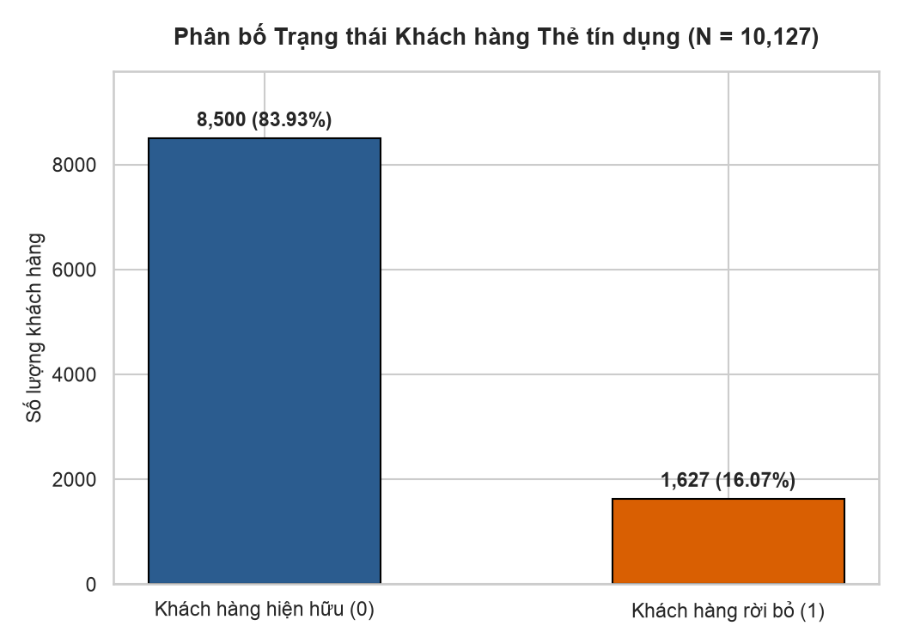
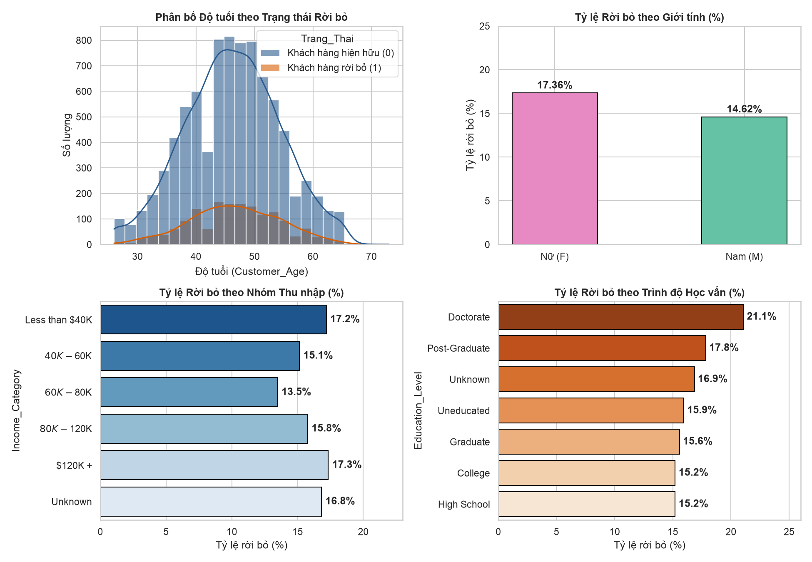
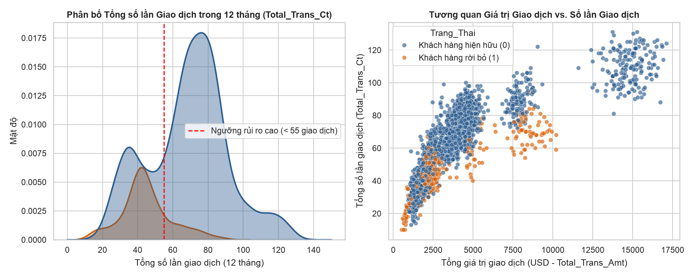
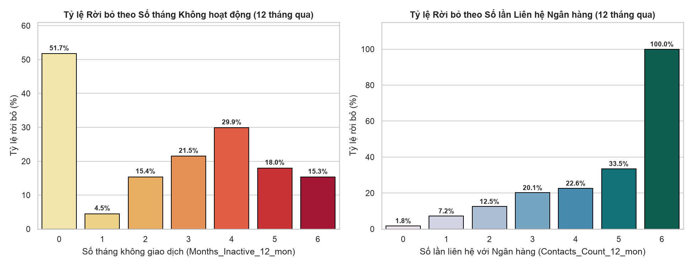
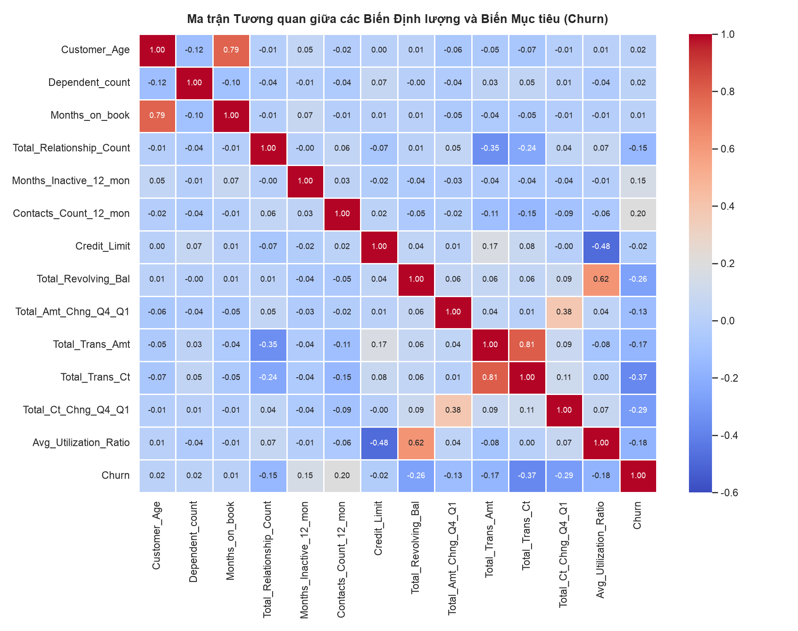
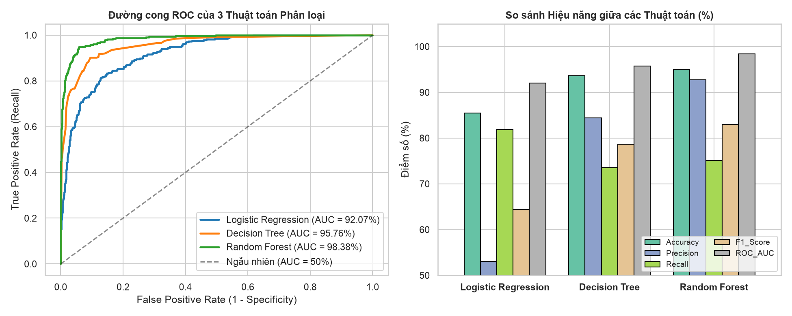
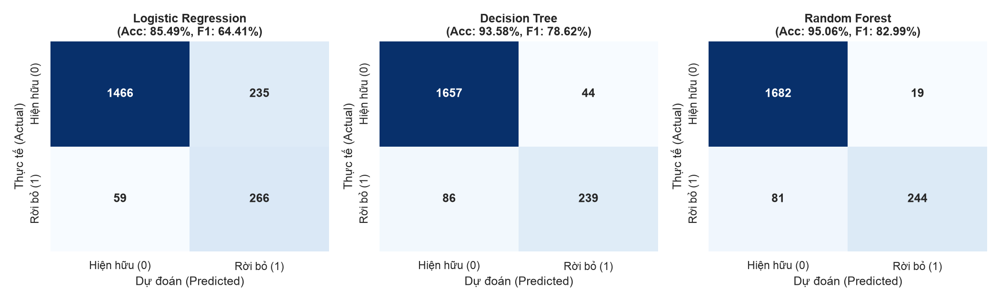
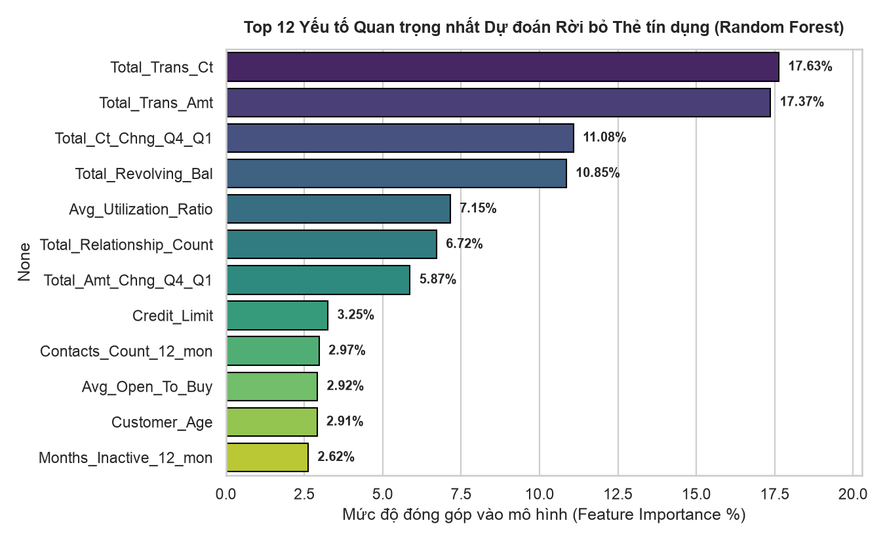

# 📊 Dự đoán Nguy cơ Khách hàng Ngừng sử dụng Dịch vụ Thẻ tín dụng (Credit Card Churn Prediction)

> **Đề tài Dự án Khoa học Dữ liệu**: Dự đoán nguy cơ khách hàng ngừng sử dụng dịch vụ thẻ tín dụng nhằm hỗ trợ ra quyết định giữ chân khách hàng tại ngân hàng.  
> **Nguồn dữ liệu**: [Credit Card Customers - Kaggle (`sakshigoyal7/credit-card-customers`)](https://www.kaggle.com/datasets/sakshigoyal7/credit-card-customers)  
> **Quy mô dữ liệu**: `10,127` khách hàng × `20` thuộc tính đặc trưng  
> **Thuật toán phân tích**: `Logistic Regression`, `Decision Tree`, `Random Forest`

---

## 🎯 1. Đặt vấn đề & Mục tiêu

Trong hoạt động ngân hàng bán lẻ, chi phí thu hút một khách hàng mở thẻ tín dụng mới cao gấp **5 – 7 lần** so với chi phí giữ chân khách hàng hiện hữu. Dự án này xây dựng quy trình Khoa học Dữ liệu khép kín nhằm:
1. Phân tích khám phá dữ liệu (EDA) để tìm ra các nguyên nhân cốt lõi khiến khách hàng hủy thẻ.
2. Huấn luyện và so sánh hiệu năng của 3 thuật toán học máy: **Logistic Regression**, **Decision Tree**, và **Random Forest**.
3. Đề xuất **Hệ thống Hỗ trợ Ra quyết định (Decision Support System)** giúp ngân hàng can thiệp sớm và giữ chân khách hàng có nguy cơ rời bỏ cao.

---

## 📁 2. Cấu trúc Thư mục Dự án

```text
├── BankChurners.csv                        # Tập dữ liệu gốc (10,127 bản ghi khách hàng)
├── Credit_Card_Churn_Analysis.ipynb        # Jupyter Notebook phân tích & huấn luyện mô hình (đã chạy sẵn output)
├── Bao_Cao_Du_An_Khoa_Hoc_Du_Lieu.docx     # Báo cáo hoàn chỉnh định dạng Word (.docx)
├── run_analysis.py                         # Script Python chạy toàn bộ pipeline EDA & Machine Learning
├── results_summary.json                    # Kết quả thống kê và độ đo đánh giá mô hình
├── requirements.txt                        # Danh sách thư viện Python cần thiết
└── charts/                                 # Bộ 8 biểu đồ phân tích trực quan độ phân giải cao (.png)
```

---

## 📈 3. Phân tích Khám phá Dữ liệu (EDA)

### 3.1. Phân bố Trạng thái Khách hàng & Nhân khẩu học
- **Khách hàng hiện hữu (`Existing Customer`)**: `8,500` khách hàng (**83.93%**)
- **Khách hàng rời bỏ (`Attrited Customer`)**: `1,627` khách hàng (**16.07%**)

<p align="center">
  
</p>

<p align="center">
  
</p>

### 3.2. Hành vi Giao dịch & Tương tác Ngân hàng
- **Tần suất giao dịch (`Total_Trans_Ct`)**: Khách hàng hiện hữu thực hiện trung bình **68.67 lần/năm**, trong khi nhóm rời bỏ chỉ đạt **44.93 lần/năm** (vùng rủi ro cao tập trung ở ngưỡng **< 55 giao dịch/năm**).
- **Số lần liên hệ tổng đài (`Contacts_Count_12_mon`)**: Khách hàng liên hệ từ **3 lần trở lên** có tỷ lệ hủy thẻ tăng mạnh; đặc biệt **100% khách hàng liên hệ 6 lần/năm đều hủy thẻ**.

<p align="center">
  
</p>

<p align="center">
  
</p>

<p align="center">
  
</p>

---

## 🤖 4. Kết quả Huấn luyện & Đánh giá Mô hình (Test Set = 2,026 mẫu)

| Thuật toán | Accuracy (%) | Precision (%) | Recall (%) | F1-Score (%) | ROC-AUC (%) | Đánh giá nổi bật |
| :--- | :---: | :---: | :---: | :---: | :---: | :--- |
| **Logistic Regression** | 85.49% | 53.09% | **81.85%** | 64.41% | 92.07% | **Recall cao nhất**, hạn chế tối đa việc bỏ sót khách hàng rời bỏ |
| **Decision Tree** | 93.58% | 84.45% | 73.54% | 78.62% | 95.76% | Cung cấp bộ luật `IF-THEN` trực quan cho bộ phận nghiệp vụ |
| **Random Forest** | **95.06%** | **92.78%** | 75.08% | **82.99%** | **98.38%** | **Hiệu năng tổng thể cao nhất** trên tập kiểm thử |

<p align="center">
  
</p>

<p align="center">
  
</p>

### Mức độ Quan trọng của các Biến (Feature Importance - Random Forest)
5 yếu tố đóng góp lớn nhất vào dự đoán rời bỏ thẻ tín dụng:
1. `Total_Trans_Ct` (**17.63%**): Tổng số lần giao dịch trong 12 tháng
2. `Total_Trans_Amt` (**17.37%**): Tổng giá trị giao dịch trong 12 tháng
3. `Total_Ct_Chng_Q4_Q1` (**11.08%**): Tỷ lệ thay đổi số lần giao dịch Quý 4 so với Quý 1
4. `Total_Revolving_Bal` (**10.85%**): Tổng dư nợ tín dụng quay vòng
5. `Avg_Utilization_Ratio` (**7.15%**): Tỷ lệ sử dụng hạn mức tín dụng trung bình

<p align="center">
  
</p>

---

## 💡 5. Đề xuất Giải pháp Hỗ trợ Ra quyết định (Decision Support)

| Phân nhóm Rủi ro | Điều kiện kích hoạt (Rule) | Quyết định Can thiệp Đề xuất |
| :--- | :--- | :--- |
| **Nhóm 1: Suy giảm tần suất quẹt thẻ** | `Total_Trans_Ct < 55` và `Total_Ct_Chng_Q4_Q1 < 0.65` | Tự động gửi ưu đãi **Cashback 5–10%** hoặc miễn phí thường niên nếu khách hàng phát sinh $\ge 5$ giao dịch trong 30 ngày tới. |
| **Nhóm 2: Bức xúc dịch vụ / Khiếu nại** | `Contacts_Count_12_mon >= 3` hoặc `Months_Inactive_12_mon >= 3` | Gắn cờ **Cảnh báo Đỏ** trên CRM và chuyển thẳng tới **Bộ phận Chăm sóc Khách hàng Ưu tiên (Retention Team)** ngay từ lần liên hệ thứ 3. |
| **Nhóm 3: Ngủ đông hạn mức tín dụng** | `Total_Revolving_Bal == 0` và `Avg_Utilization_Ratio < 0.10` | Đề xuất gói **Chuyển đổi trả góp 0% lãi suất** trên ứng dụng ngân hàng số để tăng mức độ gắn kết tài chính. |

---

## 🚀 6. Hướng dẫn Chạy lại Dự án

```bash
pip install -r requirements.txt
python run_analysis.py
```
